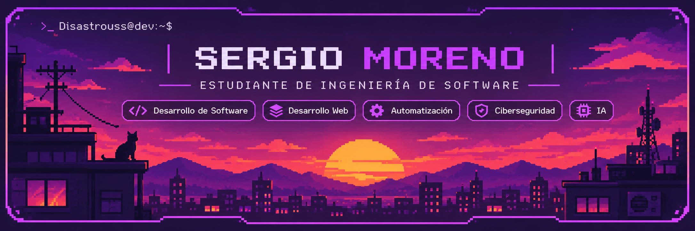

### 👾 Bienvenido a mi espacio digital

**Estudiante de Ingeniería de Software | Desarrollador de Software**

---

## 👨🏻‍💻 Sobre mí

Soy estudiante de Ingeniería de Software, apasionado por la tecnología, la programación y la creación de soluciones digitales.

Me interesa explorar nuevas tecnologías, comprender cómo funcionan los sistemas y desarrollar habilidades que me permitan construir software de calidad.

- 🎓 Estudiando Ingeniería de Software.
- 💻 Interesado en desarrollo de software y tecnologías web.
- 🔍 Explorando nuevas herramientas y tecnologías.
- 🚀 En constante aprendizaje y evolución.

---

## ⚙️ Tecnologías y herramientas

### Lenguajes de programación

### Desarrollo web

### Bases de datos

### Entorno de desarrollo

---

## 🧠 Áreas de interés

---

---

### ⚡ Siempre aprendiendo. Siempre evolucionando.

*El código es una herramienta. La creatividad es el límite.*

